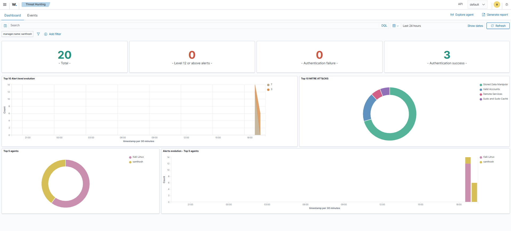
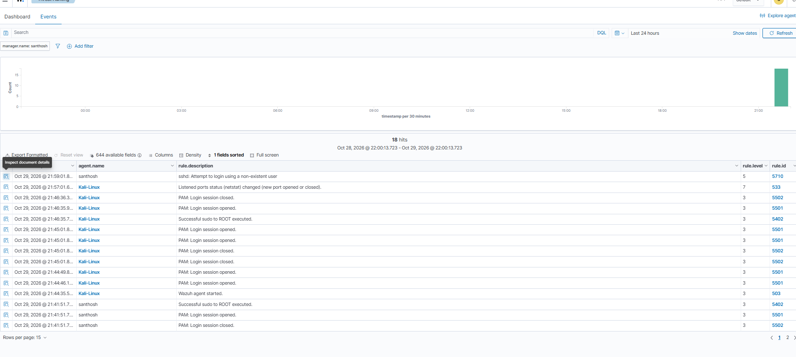
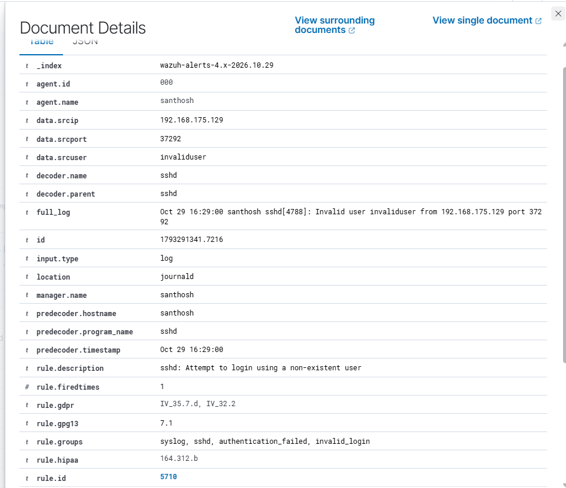

# SOC Analyst Portfolio

## Project 1: SIEM Monitoring and Threat Hunting with Wazuh

### Objective
Build a home SOC lab to monitor Linux endpoint activity, collect security events, and investigate alerts using Wazuh SIEM.

### Lab Environment
- **SIEM:** Wazuh 4.14.9
- **Server OS:** Ubuntu Linux
- **Monitored Endpoint:** Kali Linux
- **Virtualization:** VMware
- **Skills:** SIEM monitoring, Linux logs, alert investigation, threat hunting

### Lab Architecture
Kali Linux Endpoint → Wazuh Agent → Wazuh Manager → Wazuh Dashboard

### Implementation
1. Installed Wazuh on an Ubuntu virtual machine.
2. Installed and configured the Wazuh agent on Kali Linux.
3. Connected the endpoint to the Wazuh server.
4. Verified that the Kali Linux agent appeared as Active in the dashboard.
5. Opened Threat Hunting to investigate collected security events.

### Observed Events
- Wazuh agent started.
- Linux authentication and PAM events.
- Successful sudo activity.
- Security Configuration Assessment (SCA) findings.

### Investigation Approach
- Reviewed event timestamps and rule IDs.
- Checked event descriptions and affected agents.
- Distinguished normal administrative activity from events requiring further investigation.
- Used the Threat Hunting dashboard to review collected events.

### Current Status
The SIEM server and endpoint agent have been configured. Threat Hunting displays collected events. File Integrity Monitoring for a custom file in `/home/kali` still requires configuration and validation.

### Learning Outcomes
- Understanding SIEM architecture.
- Deploying and connecting a Wazuh agent.
- Reviewing Linux security events.
- Investigating alerts and authentication activity.
- Documenting findings for a SOC portfolio.

### Future Improvements
- Configure File Integrity Monitoring for a test directory.
- Generate controlled authentication events and investigate the resulting alerts.
- Map relevant detections to MITRE ATT&CK.
- Add screenshots and investigation notes.

**Note:** This is a personal home lab. Events are investigated for learning purposes; no unauthorized systems are tested.
## Project Screenshots

### Wazuh SIEM Dashboard

### Wazuh Security Events

## Project 2: SSH Failed Login Detection with Wazuh

### Objective
Detect and investigate SSH login attempts using Wazuh SIEM in a controlled home lab.

### Lab Environment
- SIEM: Wazuh 4.14.9
- Server: Ubuntu Linux
- Monitored Endpoint: Kali Linux
- Tools: Wazuh Dashboard, SSH, Linux authentication logs

### Implementation
1. Connected the Kali Linux endpoint to the Wazuh server.
2. Generated a test SSH login attempt using a non-existent username in my own lab.
3. Reviewed the resulting security event in Wazuh Threat Hunting.
4. Examined the event details, including source IP, attempted username, timestamp, rule ID, and severity.

### Investigation Findings
- Event: SSH attempt to log in using a non-existent user.
- Rule ID: 5710
- Severity Level: 5
- Source IP: 192.168.175.129
- Attempted Username: invaliduser
- MITRE ATT&CK: Credential Access — Password Guessing (T1110.001)

### Analyst Conclusion
Wazuh detected the invalid SSH username attempt and generated an alert. A single event does not confirm a brute-force attack; additional attempts and surrounding logs should be reviewed before classifying it as malicious.

### Evidence

**Note:** This project was performed in my own authorized home lab for learning purposes.
